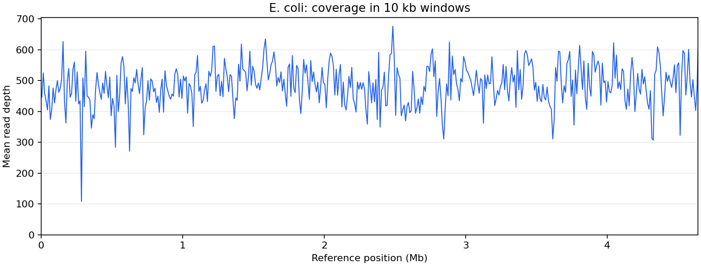

# E. coli read mapping: short report

## Data and method

I mapped the complete `ERR022075_1.fastq.gz` file as single-end reads to
E. coli K-12 MG1655, assembly `GCF_000005845.2_ASM584v2`, chromosome `NC_000913.3`
(4,641,652 bases). I used only mate 1, as requested in the assignment;
mate 2 was not downloaded. No subsampling or preprocessing was applied.
Both input files match the MD5 checksums published by ENA and NCBI
(see [input_checksums.json](results/input_checksums.json)).

I used **Bowtie 2 version 2.5.5**, with `--very-sensitive-local -k 2 --seed 42
--reorder -p 8`. The algorithms are the Burrows-Wheeler transform / FM-index,
multiseed search on both strands, and gapped dynamic-programming extension.
Bowtie 2 does the alignment; my Python code validates FASTQ records, parses SAM,
counts alternative placements, and calculates alignment quality and coverage.
It does not reimplement Bowtie 2.

Local alignment can clip read ends. Its default minimum score is
`20 + 8 ln(read_length)`; at 100 bases this is about 56.84.
I therefore report both identity and the fraction of retained read bases.

## Measured results

| Measurement | Result |
|---|---:|
| Reads processed (entire mate-1 file) | 22,720,100 |
| Read bases processed | 2,272,010,000 |
| Mapped reads | 22,581,640 |
| Unmapped reads | 138,460 |
| Mapping rate | 99.3906% |
| One reported placement, among all reads | 95.2356% |
| Multiple reported placements, among all reads | 4.1550% |
| One reported placement, among mapped reads | 95.8196% |
| Multiple reported placements, among mapped reads | 4.1804% |
| Pooled alignment identity | 99.7183% |
| Mean edit distance per mapped read | 0.2814 |
| Mean alignment score (AS) | 198.5295 |
| Retained bases, among bases of mapped reads | 99.8884% |
| Mapped reads retaining at least 80% of their bases | 99.8989% |
| Genome positions covered at least once | 4,640,951 |
| Genome coverage (breadth, >=1x) | 99.9849% |
| Mean depth, including uncovered positions | 485.9507x |
| Genome covered at >=10x | 99.9294% |
| Genome covered at >=30x | 99.8351% |
| Alignment + input validation + statistics time | 1500.0 s (25.00 min) |

Read lengths: `{'100': 22720100}` (length in bases: number of reads).
The run used 8 alignment threads on Windows x86-64, with Python 3.10 and NumPy 2.2.6.
Runtime excludes downloading the data and building the reference index.
The run began at `2026-11-15T23:03:00+00:00` and ended at `2026-11-15T23:28:00+00:00`.

Only 701 reference positions remain uncovered.
The high mapping rate is accompanied by 99.8884% retained
bases in mapped reads, so it is not explained by extensive end clipping.
Coverage varies along the chromosome, as shown by the 10 kb windows.

## How the measurements are defined

**Unique / multi-mapped:** with `-k 2`, one primary alignment with no secondary
alignment is counted as one reported placement (operationally unique), and a primary
plus a secondary alignment is counted as multi-mapped. There are
21,637,631 one-placement and 944,009
multi-placement reads. A secondary alignment may have a worse score than the primary;
this is not a count of equally best hits. Bowtie 2 uses heuristics, so one reported
placement is not proof that no other valid placement exists. It reports at most two
placements here; the exact number of repeat copies is not measured.

**Alignment quality:** identity is `100 * (C - sum(NM)) / C`, where C is the sum of
CIGAR `M`, `=`, `X`, `I`, and `D` lengths over primary mapped alignments. NM counts
mismatches and inserted/deleted bases. Soft-clipped bases are excluded from identity,
and shown separately through retained-base statistics. Mean edit distance is
`sum(NM) / mapped_reads`. MAPQ is not used as a confidence estimate because Bowtie 2
does not provide meaningful MAPQ in `-k` mode.

**Coverage:** each reference position in a primary `M`, `=`, or `X` block receives
one count, including substitutions. Insertions, deletions, soft clips and secondary
alignments do not add depth. Mean depth divides the sum of depths by the complete
reference length, including zero-depth positions. Multi-mapped reads contribute
only their chosen primary alignment. Coverage is calculated with a difference array
and a cumulative sum, so it does not loop over every aligned base in Python.

## Checks and limitations

The input reader validates all four lines of each FASTQ record and checks that read
and quality lengths agree. FASTQ read/base counts must match the primary SAM counts.
The Bowtie 2 log, depth histogram and window coverage are checked against the JSON
metrics. Five small tests check indels, clipping, reverse-strand records, secondary
alignments, the reference boundary, uncovered positions, and malformed FASTQ input.

These are mapping measurements, not accuracy against known true read origins.
No duplicate removal, base-quality filtering, adapter trimming or circular-boundary
handling is performed. Local alignments can count partially matching reads as mapped.
Alternative hits are limited by Bowtie 2's heuristic search and `-k 2`; the selected
primary is not guaranteed to be the global best among every possible alignment.
The chromosome is treated as linear. The coverage figure uses 10 kb averages;
the exact breadth and depth statistics use individual reference positions.

The reference is only about 4.6 Mb, so an FM-index fits comfortably in memory.
Streaming SAM avoids saving a large alignment file. A 1,000-read SAM excerpt is
saved locally for inspection and excluded from Git. No read sequences are published;
all numerical results come from the complete input file.

## Sources

- [NCBI reference FASTA](https://ftp.ncbi.nlm.nih.gov/genomes/all/GCF/000/005/845/GCF_000005845.2_ASM584v2/GCF_000005845.2_ASM584v2_genomic.fna.gz)
- [ENA mate-1 FASTQ](https://ftp.sra.ebi.ac.uk/vol1/fastq/ERR022/ERR022075/ERR022075_1.fastq.gz)
- [Bowtie 2 manual](https://bowtie-bio.sourceforge.net/bowtie2/manual.shtml)
- [Bowtie 2 paper](https://doi.org/10.1038/nmeth.1923)

The supplied [example project](https://github.com/iaraha/Genome-mapping) was used
as a guide for report structure. Its code and numerical results were not reused.
Its whole-read, up-to-four-error mapping rule differs from the local alignment
rule used here, so mapping percentages are not directly comparable.
